# 氨氧化法制硝酸

## Ⅰ 氨氧化法制硝酸

用鉑和鉑-銠合金作接触剂，将氨-空气混合气进行氧化作用，使氨氧化生成一氧化氮，再氧化成二氧化氮，然后用水吸收制成硝酸，这种的方法已有很长久的历史了。采用这个方法制造硝酸的过程可以分作二个步骤：

1. 氨-空气混合气经鉑銠接触剂氧化成一氧化氮反应如下：

$$
4\mathrm{NH_3}+5\mathrm{O_1}=4\mathrm{NO}+6\mathrm{H_2O}+216{,}700\,\text{卡}
$$

2. 一氧化氮氧化成二氧化氮，并经水吸收生硝酸反应如下:

$$
2\mathrm{NO}+\mathrm{O_2}=2\mathrm{NO_2}+29{,}500\,\text{卡}
$$

$$
3\mathrm{NO_2}+\mathrm{H_2O}=2\mathrm{HNO_3}+\mathrm{NO}+17{,}590\,\text{卡}
$$

> 校注：第一式扫描件的氧下标形似“1”，原式照录；通常应为 $\mathrm{O_2}$。原图还用连线表示第三式生成的 NO 返回第二式。

过去，用此方法生产硝酸的设备装置都系大型洋法的，氨氧化用的接触剂为价值昂贵的鉑銠合金网，氨氧化接触器(俗称氨氧化炉）是高鉻鋼制造的。吸收部分又需用大量的不鏽鋼材作为酸吸收塔，鼓风机，酸泵及输送气体、液体等管道，但在目前国内对不锈钢材还不能大量供应时，用“洋法”来制造硝酸，要普遍地推广，还存在着一定的困难。土法的氨氧化法制硝酸的主要目的是解决设备材料的供应困难，因地制宜，就地取材，采用价格低廉的“土”材料，并且简化生产流程，使投资费用大大降低于“洋”法的投资，操作易于掌握，符合遍地推广

## 一、 生产流程

=== "SVG 重绘"

    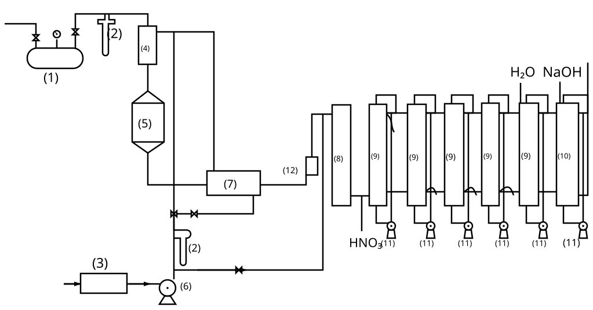

=== "原书扫描"

    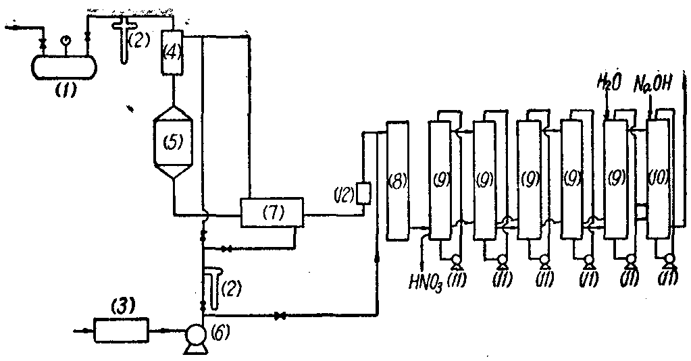

氨氧化制硝酸流程图

(1)氨稳压器(2)流量计(3)空气过滤器（4)氨-空气混合器(5)氨氧化器（6)鼓风机（7)热交换器(8)氧化塔（9)酸吸收塔（10）碱液吸收塔（11）泵浦(12)冷却器

氨在鋼瓶中用热水或蒸气加热，使其气化通入稳压器(1）中，由控制閥門来控制氨的流量。通过孔板流量計(2)計氨的流量，然后进入氨-空气混合器(4)中与空气混和。

空气經过过滤器（3)过滤去灰尘杂质后，经鼓风机（6）送入生产系统中，鼓风机出口装有閥門控制空气流量，通过流量计(2)計空气流量。空气分二部分送入混合器（4)中，一部分經过热交换器（7)；利用氨氧化炉出口热气体加热空气，另一部分直接送入混合气中。热空气在氨混合器中(4)充分混和后通入氧化炉(5)中，炉中装有触媒（铁鉻氧化物或铁鉍氧化物单独作触媒用或将一張鉑网与铁鉍触媒結合使用，前者氧化率可达85%~90%，后者氧化率可达96%)，氨-空气混合气体靠触媒作用将氨氧化成一氧化氮，同时发生大量热能(氨氧化反应时的反应热)，热的氧化氮气体经过热交换器（7）加热空气（为了充分利用热能，可以另加装一个热水器，使其产生热水用来蒸发液氨鋼瓶中的氨）。

氧化氮气体出热交换器(7)后，送入冷却器(12)中，使氧化氮气体充分冷却，然后进入氧化塔(8)中，使一氧化氮氧化成二氧化氮。在鼓风机（6)出口有一支路，送少量的空气入氧化塔中，使其有足够的氧气将一氧化氮氧化成二氧化氮。

氧化塔出口的气体送入五个吸收塔(9)中进行吸收，但在第五个吸收塔中将水加入，每个吸收塔都有酸泵浦(11)的设备，将酸在塔内循环吸收二氧化氮。在第五个吸收塔中吸收成的硝酸濃度较淡，因此，必需送入第四塔中再进行吸收，输送的方法是靠塔間液位的高低；使第五塔的酸逐漸流入第四塔中，再順次流入第一塔中，成品酸就由第一塔中流出，其濃度可达45%以上。

因为吸收过程中是一个放热反应，所以循环吸收的酸液应給其充分冷却，一般的每个泵浦出口或进口加装酸冷却器来进行冷却。

在第五个塔出口的气体中，尚有部分的氧化氮气体没有被水吸收，所以在最后加装一个尾气吸收塔；用碱水来吸收少量的氧化氮气体，这个塔内可以生产一部分亚硝酸钠的溶液(如果不加装尾气塔亦可以的）。

## 二、 单件设备構造及其作用

以下设备的规格系按日产100%硝酸1.5吨左右来考虑的，如果产量需要变动，则可适当调整。

## （1) 空气过滤器：

以氧化法制造硝酸所用的空气必须清净，否则，会使氨接触氧化器中所装的接触剂毒化，而使接触剂的活性降低或严重的可使其完全失效，因此，从大气中所吸入的空气必须经过处理，以除去灰尘等杂质。一般的情况下，經过过滤器可以把空气中的灰尘除去，但对有毒害的化学性气体，如硫化氢和乙炔气体等用过滤法是无法除去的，因此，必须防止此类气体，以免触媒中毒。

过滤器可用木桶制成或者用旧柴油桶改制。桶的高度约0.8米，直径为0.4米。桶内填装20×20毫米陶质环（如无陶环，可用小竹杆截成竹圈代用)。

=== "SVG 重绘"

    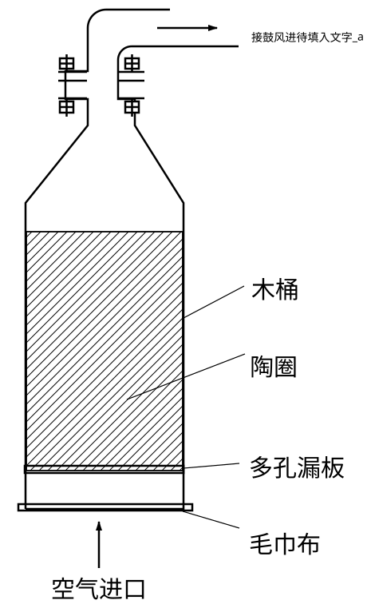

    > 此重绘图仍有待核图注，可切换到原书扫描对照。

=== "原书扫描"

    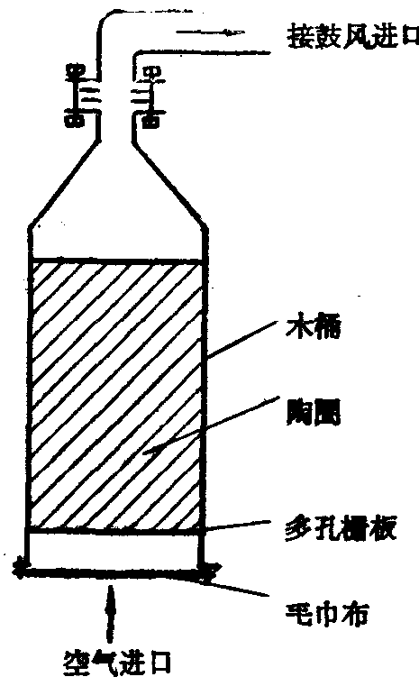

空气过滤器简图

陶环应预先洗清，乾燥后再用粘度高的机油把陶环润湿，并将多余的机油使其滴乾，然后装入桶内。在过滤器的底部用毛巾布或絨布封住，使空气先經毛巾布滤去粗灰尘，然后，在油抹过的陶环上将细小的灰尘被油粘住。毛巾布必须經常拆换清洗。陶环在使用数月后，视情况进行清洗。清洗时，将陶环取出，用火油洗去污物，然后再用机油抹上使用。

## (2) 空气鼓风机：

鼓送空气用的鼓风机，其规格为风量约350～400立方米/小时，风压为1.5~2.0米水柱，要求能使气体通过整个生产系统。一般罗茨鼓风机能达到这个要求(罗茨鼓风机俗称桃子风箱)。使用罗茨鼓风机时，必须注意轴承处不能有油漏入鼓风室内，否则，将使油随空气送入，使触媒造成不良后果。如果，采用一般离心式的鼓风机，其风压在500毫米水柱，因此，很难将空气送入系統中，必須在酸吸收塔(9)或鹼液吸收塔(10)后面加接一个抽风抽气（其风量与送风机相同）的设备。接在后面的抽风机必须用耐酸涂料（如过氯乙烯清漆等)涂刷，以防止氧化氮气体的腐蚀而损坏。

空气用量的簡单计算如下：

制造100%硝酸需用氨量为330～340公斤

每小时氨的流量为$\frac{340\times22.4}{17\times24}=18.7$ 立方米

如氨与空气混合气体中氨的濃度为9~10%，

则需用的空气为$\frac{18.7}{18.7+X}=10\%$

空气量为168.3立方米/小时

（如采用压力较低的离心式鼓风机，因后面阻力关系，影响送风量，所以鼓风机的风量要大一些）。

(3) 氨及空气的流量計:

在生产过程中，氨与空气送入氨氧化炉中的流量必须严格的控制。按照一定的比例（普通控制在9~10.5%氨的濃度体积百分比)送入，并要求保持稳定，不能变化太大，否则，将会引起生产的不正常和造成故障，因此，氨与空气必须经过流量計来計量，以便于控制氨与空气的一定比例。流量计的种类很多，如轉子流量計，压差式流量計等。氨气流量計的要求最大流量为40立方米/小时。空气则为400立方米/小时。如流量计不易購得时，可以設法自制孔板式压差流量計，因其制造简单而价格较購买者低廉得多。

孔板式压差流量計系在管道中插入一个在中心有小孔的金属薄板的装置。有小孔的金属板由一对法兰夹住。在孔板左右的适当位置，分别安装静压头的测定管，连接两管之液柱斜度压差计，根据压差而求得气体的流量。

=== "SVG 重绘"

    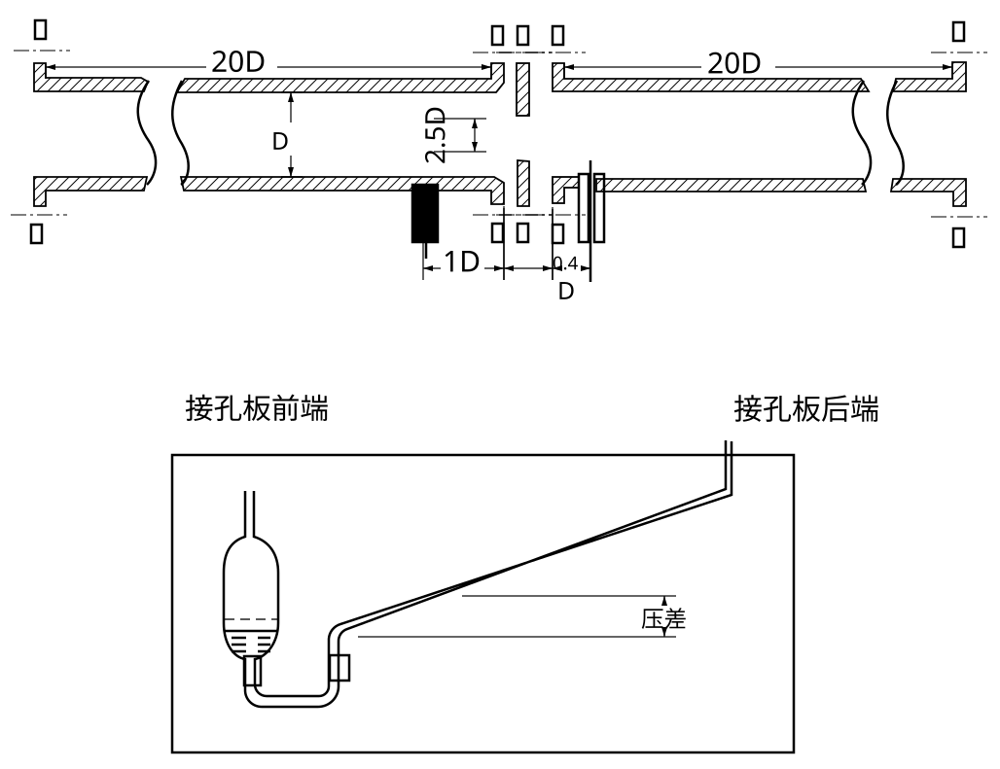

=== "原书扫描"

    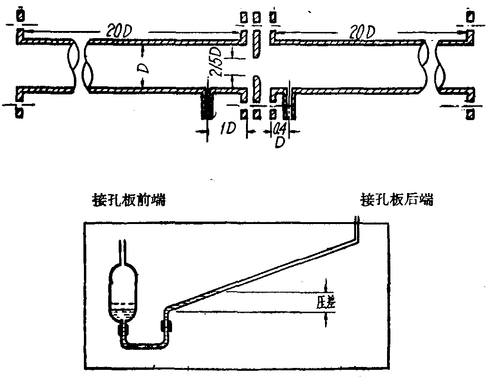

孔板式压差流量计装置图

在使用前，必须用其他准确的流量计校准过，校准的方法，在孔板流量计前端接在鼓风机上，并送入空气，这时压差计即显示出压力差，在孔板流量计的后端接一个流量计(如煤气表等)，就可以讀出該时的空气的流量，同时記录出在多少压差时;煤气表上的流量是多少。这样，以后使用时，就可以据压差的多少相当于每小时多少立方米的流量。

## (4) 氨与空气混合器：

为了使进入氨接触反应器内的氨与空气能混合均匀，而有利于在触媒层很均匀的接触反应，因此，要求在混合器中能充分的混合。如果，氨与空气混合不好，则通入触媒层时的濃度有高有低，在濃度不均勻的情况下，将造成轉化率的降低。混合器的形式很多，兹介紹制作簡单的混合器如下。

## 填充式混合器

=== "SVG 重绘"

    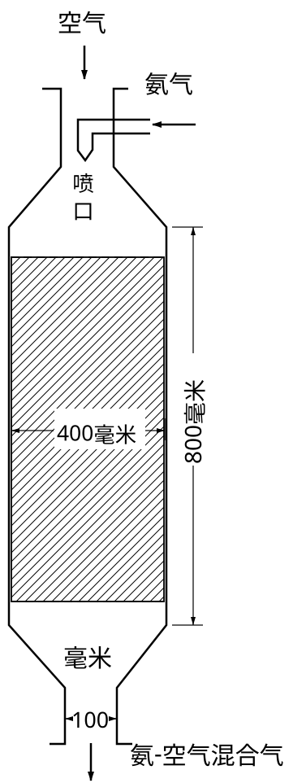

=== "原书扫描"

    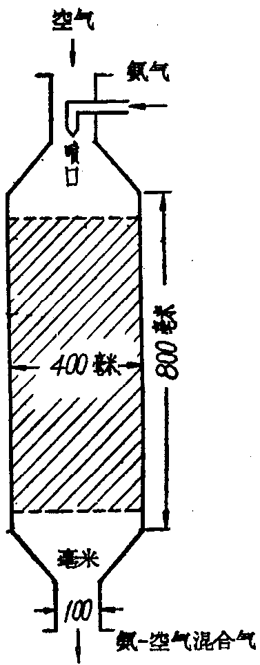

填充式混合器图

空气进口管对径为100毫米，氨气进口管对徑为30毫米，用铝制成。内部有$\mathrm{20\times 20}$ 毫米的陶环作填充，氨气进口管口有喷口，喷口管对径为10毫米。空气在氨气喷口出口与氨混合，经填充层充分混合后，出混合器而进入氨氧化器中。

## 擋板式混合器

混合器用铝制的，对徑200毫米，长約1米。内装有擋板10块，氨及空气靠擋板作用来回曲折使其充分混合。

混合器外壁必须保温，以免热量的散失。保温材料可用石棉繩包扎后，外涂紙栢泥(即石棉泥)。

=== "SVG 重绘"

    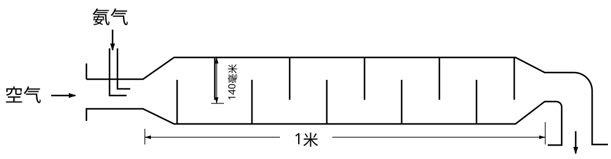

=== "原书扫描"

    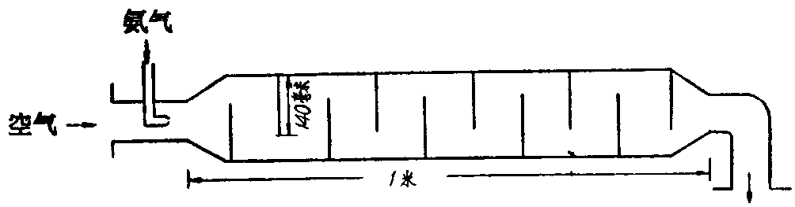

擋板式混合器图

## (5) 氨接触氧化器：

氨接触氧化器是生产硝酸主要設备

之一。氨与空气的混合气体在接触氧化器中經接触剂的作用，使氨反应生成氧化氮气体及水蒸汽。氨氧化时的反应过程是放热反应，因此，在接触剂上发生反应时放出大量的热能，所以接触氧化器是需用耐高溫的材料制成，洋法的接触器是用高鉻鋼制成。这里介紹的是用耐火磚制的接触器。

氨-空气混合气自炉顶100毫米的铝管通入炉中，炉盖为铝板制成的錐体，与平面成45度角度，以便使气体能均匀通过触媒(如制成65度角度更好)。炉盖与炉子有石棉用罗絲夹紧，以免氨气漏出。在炉盖上装有视孔二个，孔的对径为100毫米，以便操作时观察炉内反应情况，孔上装有透明的云母板。在开车时观孔亦可作为点火孔用，点火时，将云母板拆去，

=== "SVG 重绘"

    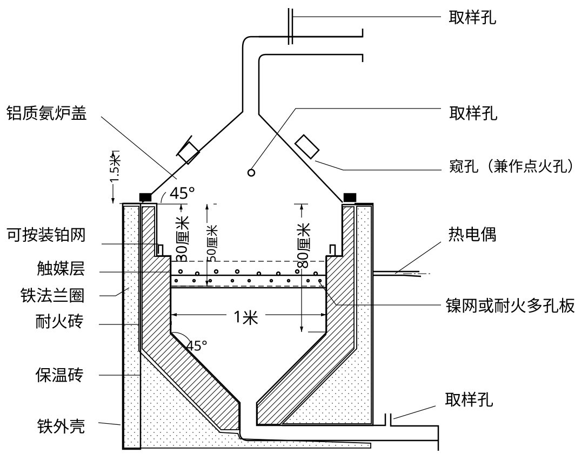

=== "原书扫描"

    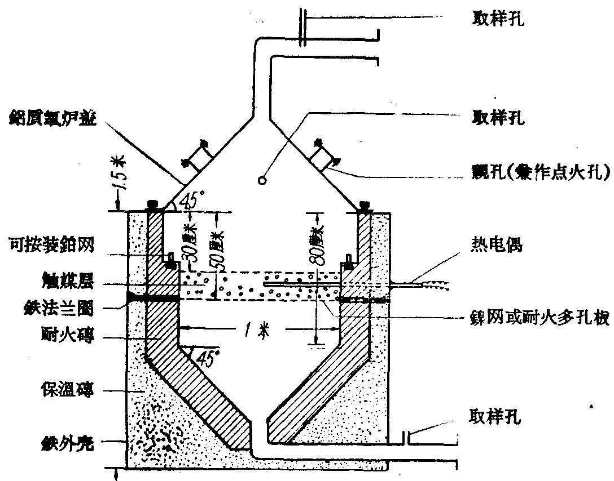

非鉑触媒用氨氧化炉图

（如按装一层鉑网，炉子对徑应减小至0.46米）

用氢焰管通入加热。炉子本身为铁壳制成（可以用旧柴油桶拼制），内衬保温磚約12厘米，内部再由耐火砖砌成，因反应时发生大量的热量，因此，耐火外面再用保温磚以使絕热。在离炉顶处30厘米处砌有法兰圈，以便按装一层铂网（如单独使用非铂触媒，可以省去此类装置)。离炉顶50厘米处安装一层镍网，以备放触媒用(如无镍网，可用不锈鋼网，规格为每吋16眼。如有耐火多孔板，亦能使用，孔眼的对径应小于触媒的粒度，而且扎眼的总面积应大一些，以免使气体通过时阻力太大)。在触媒层的中間，装有鉻铝热电偶，以便测量反应的温度。自离炉顶80厘米处以下，砌成錐体，下接铁管出口。下部砌成錐体可使气体均匀的流过整个触媒层(如砌成60°角度更好)。往往由于炉子气流不均匀，就造成了触媒层某一部分反应剧烈，而另一部分反应緩慢。触媒表面反应不均匀，很可能反应缓慢的地方会有氨滑过，这样就造成反应后，气体内含有氨而产生了硝酸铵白霧。因此，在砌炉子时應特别注意这个問题。

所开的视孔应能看出整个触媒层反应的情况，同时，因为视孔也用作点火孔，所以应能在点火时，使火焰整个喷着在触媒层表面。

=== "SVG 重绘"

    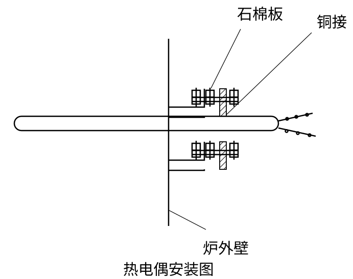

=== "原书扫描"

    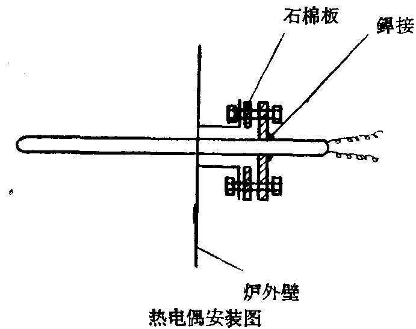

热电偶的安装应不使热电偶插入处漏气最好按左图設計。在炉壳上接一法兰，在电偶管上亦接一法兰，二个法兰接合处用石棉衬，再用罗絲夹紧。电偶插入的深度，应使电偶插入的一端在炉子中心部分。

根据目前土法生产硝酸的氧化炉，采用火砖砌成后，一般有漏气现象发生，即氨气未经触媒层，直接由火磚裂缝中漏入反应后的氧化氮气体中，以致反应后的气体中有硝酸铵白霧发生，而轉化率亦降低。因此，在填放触媒层支架处，焊铁板法兰圈一层，以防止氨气漏入下层。这样，使火砖裂缝中所漏的氨气至兰圈处时仍能通过触媒层起氧化作用，生成一氧化氮。同时在砌炉子时，应尽量防止火磚加热后产生裂缝，砌火磚的火泥应調得厚一些，在調火泥时，加入少量的水玻璃。

氧化炉的对徑根据上海化工研究院所作試驗的結果如下:

氧化炉对径150毫米。

截面积0.0177米²。

触媒层高度60毫米(铁鉍触媒)

氨濃度10.5%。

反应温度$720\sim750^{\circ}\mathrm{C}$

每天处理氨量15公斤。

所得氧化率90%左右。

因此，土法制造硝酸中的氧化炉；若每天用500公斤氨，那末，氧化炉的截面积为$\frac{500}{15}\times0.0177=0.59$ 米²

氧化炉的对径为$\frac{\pi D^2}{4}=0.59$

$\mathrm{D=0.87}$ 米

．所需触媒的量約$0.59\times0.08\times1.3=0.061$ 吨

触媒层填放的高度约在60～80毫米；在填放触媒时，以乱堆方式将触媒鋪平（上海化工研究院供应的鉄鉍触媒是对徑7毫米，厚3毫米的片状)。

如果采用一层鉑网与铁鉍触媒结合，根据上海化工研究院的实驗结果:

触媒层高度50毫米。

鉑网与触媒层间隔10毫米。

每平方米截面处理氨量为$\mathrm{3,000{\sim}3,200}$ 公斤/日。

氨濃度10.0~10.5%。

氧化率为95~97%（使用三个月后的氧化率仍能达95%以上）。

因此，如果安装一层鉑网与铁铋触媒结合使用时，那末，氧化炉的对徑就比单純使用铁鉍作触媒时小，

假使每天以处理500公斤氨计算：

$$
\frac{500\,\text{公斤}\times1\,\text{米}^2}{3000\,\text{公斤}}=0.17\,\text{米}^2
$$

$$
\text{炉的对径：}\quad\frac{\pi D^2}{4}=0.17
$$

$$
D=465\,\text{毫米}
$$

上海化工研究院曾設計以一层鉑网与铁鉍触媒結合使用作接触剂，由氨氧化生成氧化氮，用碱液在淋降塔中吸收制亚硝酸钠的小型工厂中，其氧化炉的对径为520毫米，每天处理氨量为660公斤左右，生产亚硝酸纳约2,000～2,200公斤。目前已由华元染料厂，中国染料三厂，五洲药厂及新丰印染厂等使用。

单純使用铁鉍触媒作接触剂，由氨氧化土法制硝酸已有上海化工研究院，天工酸碱厂及达丰化工厂等，因氧化炉对径不同，以致氨的处理量亦不同，但与上面所计算的情况大致符合。如将炉子对径缩小，用加高触媒层高度的方法来提高氨处理量，将使操作发生困难。

兹将上海天工酸碱厂用土法制造硝酸的流程图和氧化炉的設計图附后，以供参考。

=== "SVG 重绘"

    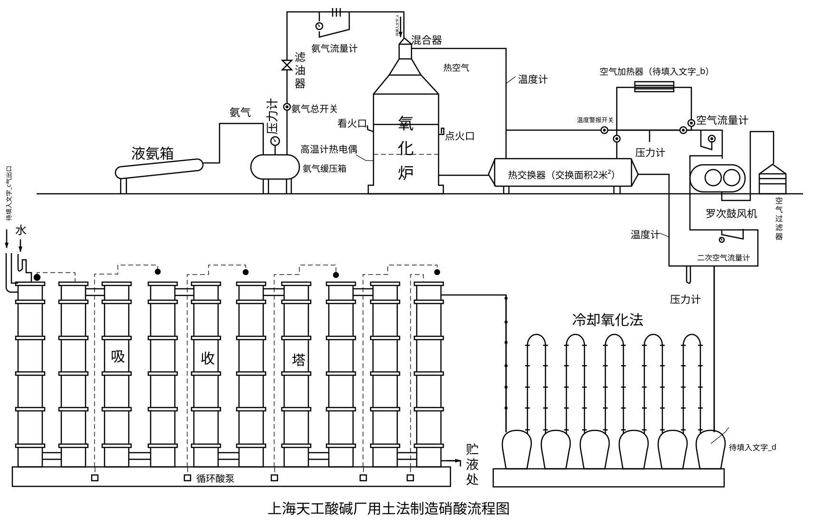

    > 此重绘图仍有待核图注，可切换到原书扫描对照。

=== "原书扫描"

    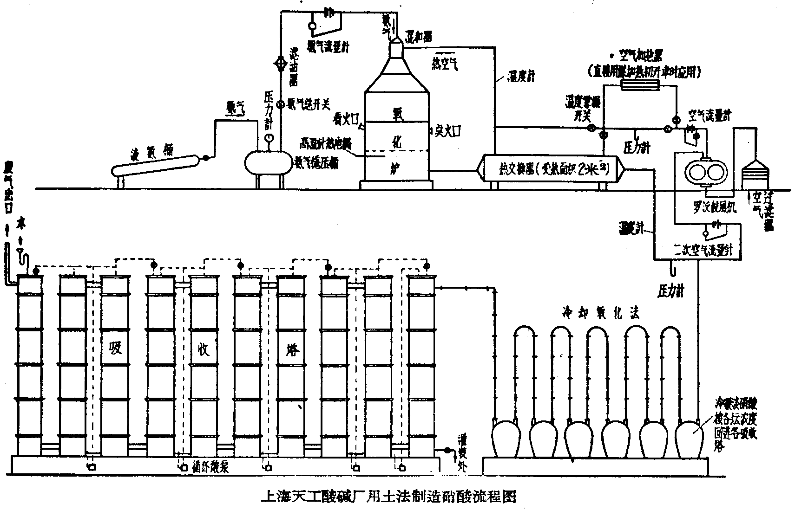

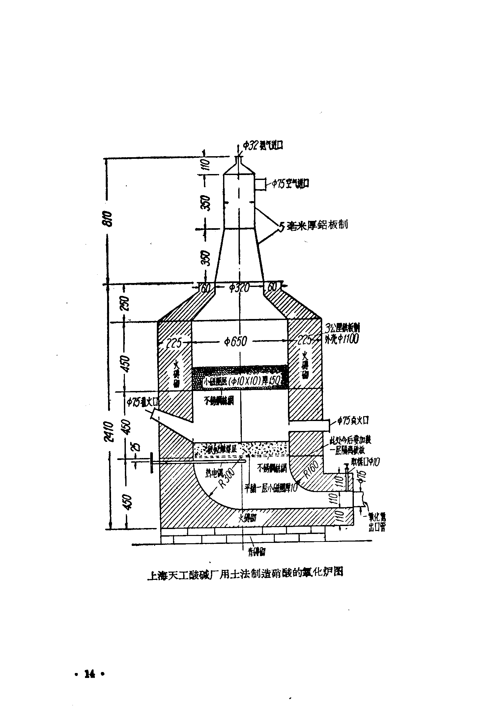

上海天工酸碱厂用土法制造硝酸的氧化炉图

**工程图重绘（用户提供）**

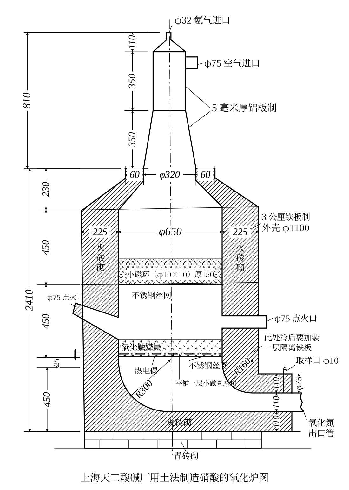

## (6) 空气预热器(热交换器)：

在进入触媒层的气体，必须保持一定的温度，这样，有利于接触反应。虽然在氨接触反应时，有反应热量发生而使触媒有一定的温，但是为了能使反应完全,维持正常的温度实属必要。预热器是利用反应后所产生的热气体；间接地来加热反应用的空气。预热器是采用列管式的，反应后的氧化氮气体；在管子中間穿过，空气在管外的室内被加热。预热器需要的散热面积约为2平方米，长1.4米，内装25毫米水汀管18根；对径为0.3米，内

=== "SVG 重绘"

    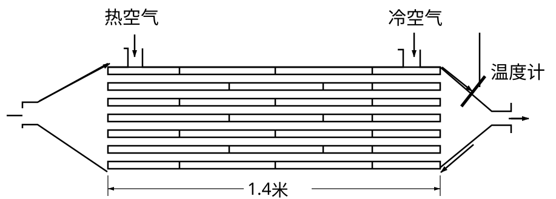

=== "原书扫描"

    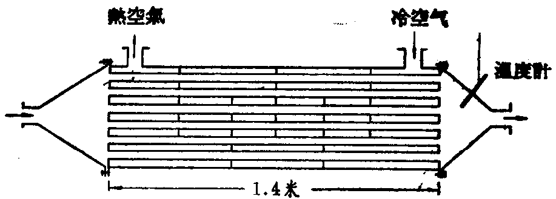

部如能做成擋板，则对热交换将更为有利。在使用时，外壳应包上纸栢泥（即石棉泥)，以防热量的损失。预热后的空气管道应有装温度计的袋，以供按装温度計之用。

## (7) 氨气穩压储存器：

作原料用的氨一般是灌在鋼瓶

=== "SVG 重绘"

    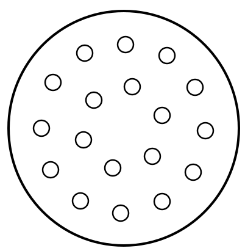

=== "原书扫描"

    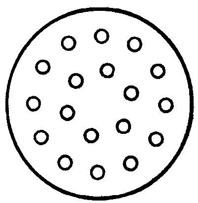

空气预热器图

中的。它是液体氨。如果，直接用鋼瓶中放出的氨送入系統中去使用是有一定困难的，因为流量不很穩定，操作上很困难，同时可能有液体氨带入；与热空气相遇会造成体积之突然增大，可能发生故障。为了要防止这种现象，应讓液氨在鋼瓶中先行气化(可以用热水淋在钢瓶上，液氨受热即行气化)后，送入氨气储存器中。储存器能耐15公斤/厘米²的压力，并装有氨压力表，以便于控

=== "SVG 重绘"

    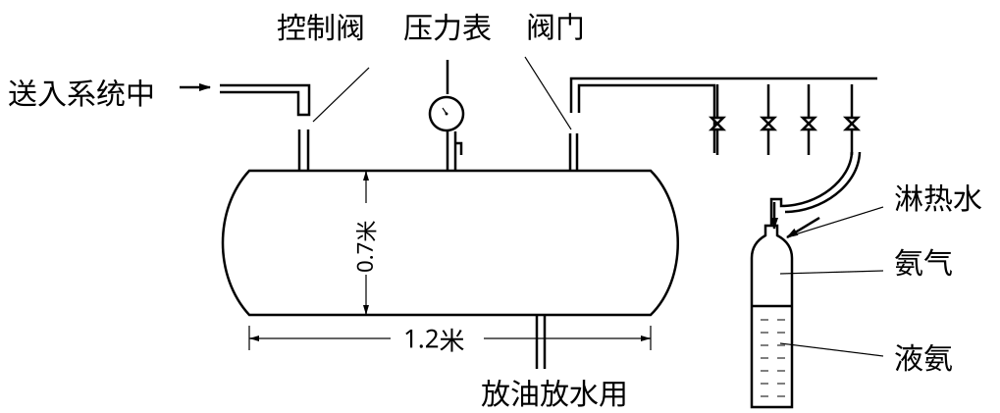

=== "原书扫描"

    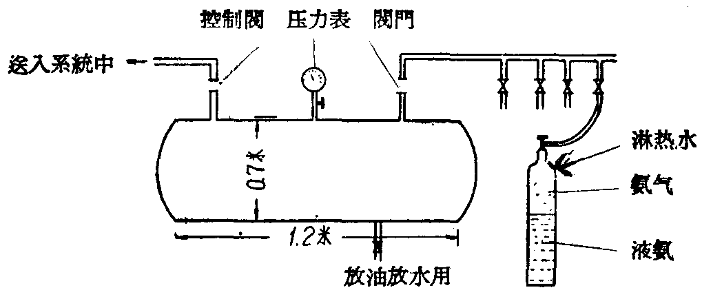

氨气稳压储存器图

制。储器用铁板制成，压力表控制在4~5公斤/厘米²压力左右。如压力过高时，可将液氨瓶上的热水取去，不使液氨蒸发，操作时只須控制出口的閥門，維持一定的流量送入系統中去。此項設备可以利用旧的設备改制，容积大小影响不大。如容积大，可使操作方便，因为存量多，就可以有足夠的时間調換鋼瓶等。

## (8) 氧化氮气体冷却器：

氧化氮气体出预热器后，它的温度一般在400℃左右。如果，需要利用热量，可以在预热器后加装一个热交换器，用以产生热水；用来蒸发液氨。这样，气体的温度約可降至150~160℃，然后进入冷却器进行冷却。氧化氮气体冷却后温度降低，一氧化氮便与空气中剩余的氧气氧化而生成二氧化氮。假使出预热器后不利用它的热，那末，则需加接铁管，使其自然冷却。否則，将使冷却器溫度变高，造成了冷却器設备的损坏(因冷却器是采用陶管或玻璃等材料制的)。但是加装的铁管，其出口处的温度应维持在120℃以上，否则，将会使铁管腐蚀。

冷却器是用陶管制成，由于陶管的傳热較差，因此，冷却器的面积须适当的放大。下面是用内徑0.1米，长2米陶管11根组成的冷却器，散热面积約7平方米。如有条件可多加几根。

平口式陶管安裝法：

=== "SVG 重绘"

    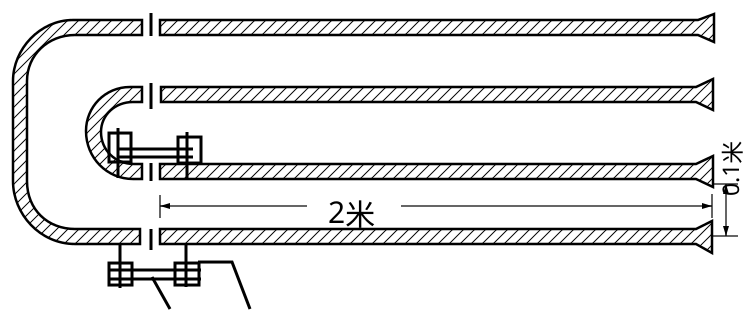

=== "原书扫描"

    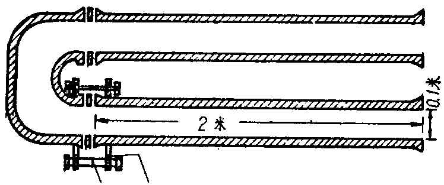

石棉板衬法兰

平口式陶管安装图

陶器直管和直管之间与弯头联接，但接合处要用石棉板衬(石棉板应先在石腊中煎过，使用时二面涂牛油)，再用法兰将其夹紧，相联排成S形。

=== "SVG 重绘"

    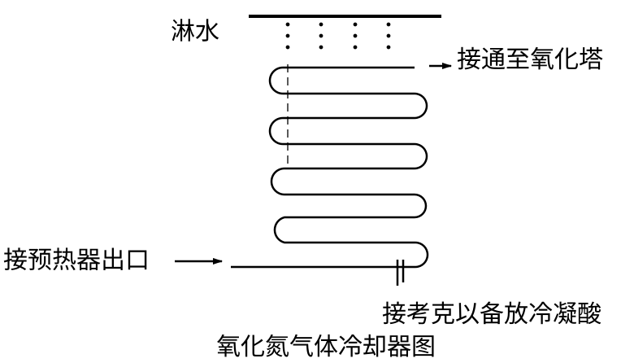

=== "原书扫描"

    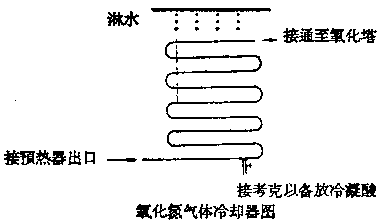

瓦筒式陶管安裝法:

瓦筒式陶管安装图

瓦筒式陶管在接口处，用浸过水玻璃的石棉繩填在接逢处；另外再用耐酸水泥或輝綠岩粉泥封住，待干燥后，即很牢固。封口

时应特别注意，如果,封口不好，将会有漏酸或漏气等情况发生。

冷却器除了陶器以外，尚可用玻璃制成，上海中国染料三厂使用玻璃管制成的冷却器，使用情况良好，而且代价较陶器管低廉得多。冷却器是用直管与弯管联接制成，形式与上面陶管的形式相同。弯管与直管接合处是用聚氯乙烯布涂上聚氯乙烯胶

=== "SVG 重绘"

    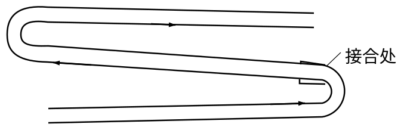

=== "原书扫描"

    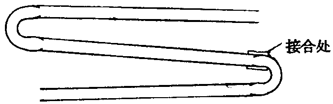

玻管的冷却器图

合剂，绕在玻璃的接处，绕三四层后，外面再用布涂过氯乙烯清漆后，再绕在聚氯乙烯布外层，待全部干后，外层再用橡皮圈套上，两端用夹子夹在玻璃壁上。整个冷却器固定装置在木架上。玻璃管直径约40毫米。整个冷却器由三排并联，每排10根。总冷却面积为10平方米左右。如能使用玻管冷却，效果就比陶管好。

## (9) 氧化塔及吸收塔：

经过冷却器冷却后的氧化氮气体进入氧化塔中，这时由于气体温度降低，进入氧化塔中的一氧化氮就渐渐氧化成二氧化氮。一氧化氮氧化成二氧化氮的比例，要看冷却的情况与氧化塔的大小以及其他許多因素而定。一般溫度低，而氧化塔的容积大，对一氧化氮的氧化是有利的。因此，在洋法生产中，有的采用冷冻机来进行冷却的，但在土法中可以采用较大的容积而不加冷却，就可以省去酸泵馬达等设备。如有条件，则加循环冷却方法。这样，将有较好的效果。在氧化塔中，由于一氧化氮的氧化是放热反应，因此，温度反而比出冷却器的气体温度为高。氧化氮气体在塔中停留4秒鐘(温度30℃时)约有25%的氧化率。

如停留1分鐘，则将有75%的氧化率(指一氧化氮氧化成二氧化氮的百分数）。

設在氧化塔中須有75%的氧化率，溫度在$30^{\circ}\mathrm{C}$ 而氧化氮气体在塔中需要停留约53秒鐘，那末，塔的容积計算如下:

通过塔的气体量约为300立方米/小时。

$$
\frac{300\times13}{60\times60}=4.4\,\text{立方米}\quad\text{氧化塔容积}
$$

如果冷却的情况好，则容积可适当的减小。一般采用5立方米已足够了。

氧化塔的构造比较简单。它是一座对徑1.0米，高6米和容积約为5立方米的塔。可以用耐酸磚或陶磚砌成，亦可用石块砌，无論选用那一种材料砌的时候,須用耐酸水泥或辉綠岩粉泥砌。砌的时候须注意磚縫严密不漏，砌好后须待完全干燥才能使用。此外，可以用水缸代替做成氧化塔，亦可用陶器大筒做成(有现成的陶器塔身供应)。下面是几种不同材料制的塔身简图，假使采用水缸或陶器瓦筒时，则应先計算每只缸的容积，然后找所需的容积算出水缸或瓦筒的只数，再行安装成塔。

1. 水缸砌的塔，所用的水缸尺寸和规格应相同。堆的时候，缸口与缸口接合，缸底与缸底接合。在接合处可用浸过水玻璃的石棉繩在接合处撓几圈，外面再用辉綠岩粉涂匀；使接合处密封。缸底上应打30毫米左右的孔约十数个，以使气体能够通过。堆缸的只数视需要容积而定。普通的七石缸其容积为每只有0.4立方米左右，那末，用12只缸，它的容积已足够了。如用12只缸堆成一只塔，则高度太高，恐生危险，于是就可以将塔分成二只，即6只作为一塔，串联或平联二塔使用。为了安全起见，缸的周围应做支架，不使其有倾斜等现象发生。在缸的上口用竹圈加固。

> 校注：原书正文写停留“53 秒”，算式分子却印作“300 × 13”，结果印作“4.4”；三者不一致。此处照录，不代替作者改算。

=== "SVG 重绘"

    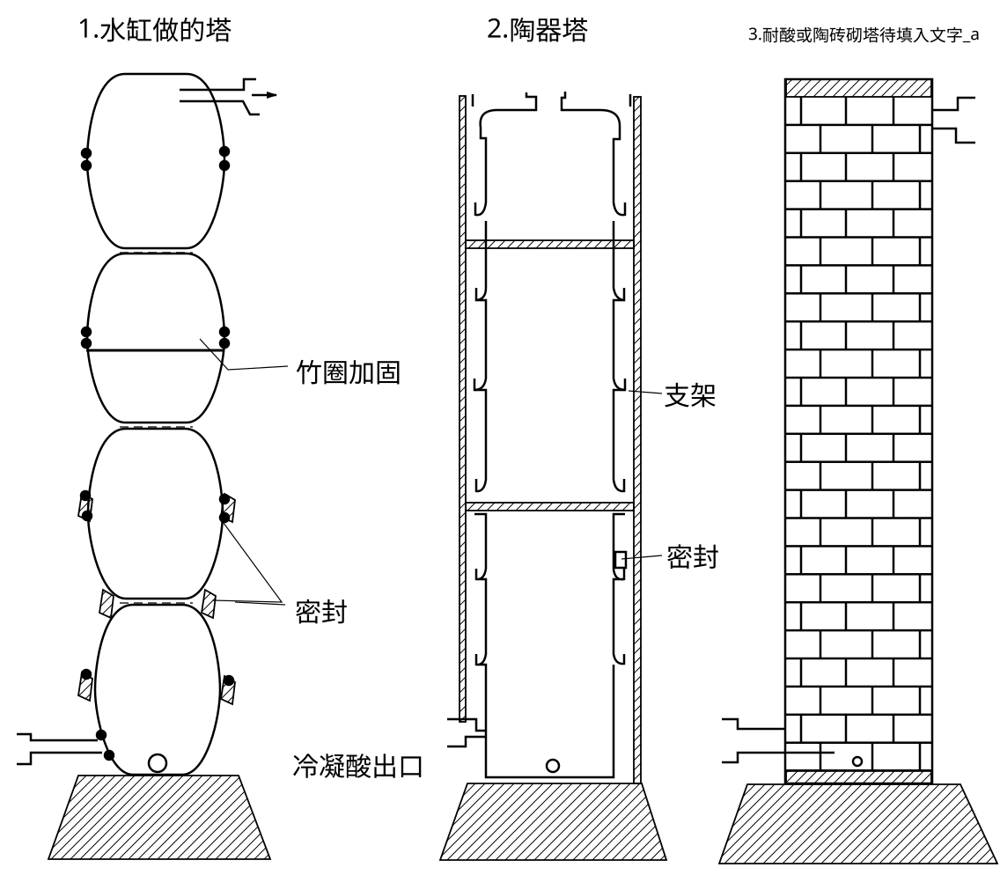

    > 此重绘图仍有待核图注，可切换到原书扫描对照。

=== "原书扫描"

    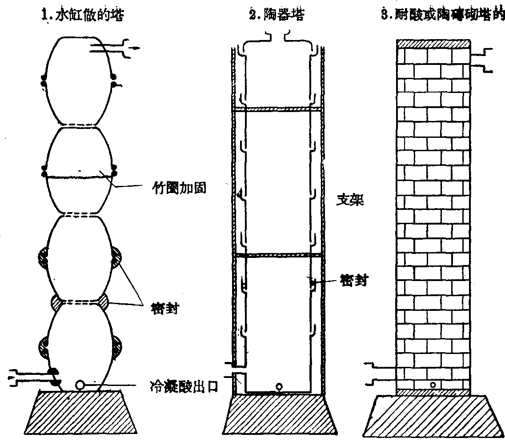

氧化塔图

2. 陶器塔安装时较为方便，接合处可与冷却器的接合方法相同。堆陶塔的时候，不应使整个塔的重量吃在底下一节塔身。这样，会造成塔身的碎裂。因每一节塔身的重量約在300公斤左右，所以最好能每二节有一铁圈；将塔身圍住，使塔身的重量吃在支架上。这样，可免塔的裂碎。塔身的只数要视塔的对徑与高度而定。

3. 耐酸磚或陶砖砌塔时，施工时间要长些，但塔的对徑可以不受限制，而且亦不需做支架。

以上三种塔，以缸的材料价格较低（普通水缸每只約十几元)，陶器与耐酸磚则价格较贵。目前上海推广使用的，大部分为缸与陶器塔，因为安装时间较快。

吸收塔的形式与氧化塔相同。吸收塔中放有陶器圈，以使二氧化氮气体在填充的陶圈表面被液体所吸收，陶圈的规格为$\mathbf{50}\times\mathbf{50}$ 毫米（如果没有陶圈，可以改用焦炭或海浮石填充，但在使用前必須經过充分冲洗，以便去除细小的粒子，以免使用后阻塞管道。另一方面在使用焦炭作填充时，不能将塔全部填满，因为填满就会使塔内氧化的空间减小，对一氧化氮的氧化不利)。

吸收塔应有泵循环吸收二氧化氮气体，并且在循环过程中须有冷却装置。如吸收塔不能堆得太高时，可以分成二排并联。

吸收塔的容积，可按每产100%硝酸1吨所需吸收容积20立方米来計算。因此，如按500公斤氨计算約可产100%硝酸1.5吨左右，所需吸收的总容积为30立方米，分成五塔；则每塔有6立方米的吸收容积。如果在冷却的情况较差或在夏天，可能吸收较差；第五塔的出口尾气管将有黄色的氧化氮气体散入空气中。这样，对产率与环境卫生都有影响。除了设法增加冷却条件外，可以适当的将产量降低(将氨的处理量减少)，或则在第五塔后加装碱液吸收塔，用其来回收廢气制取亚硝酸钠。

吸收塔安装时，不能五个塔在同一水平上。这样，将会造成移酸的困难。每座塔应相差$20{\sim}30$ 厘米高度，以便使第五塔内的酸能溢入第四塔，相繼的向前溢入第一塔中。

=== "SVG 重绘"

    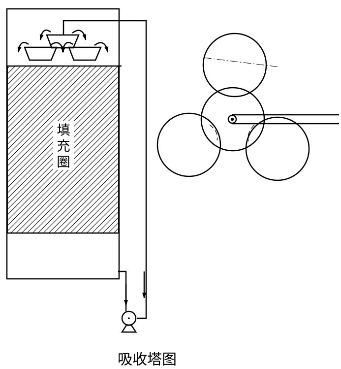

=== "原书扫描"

    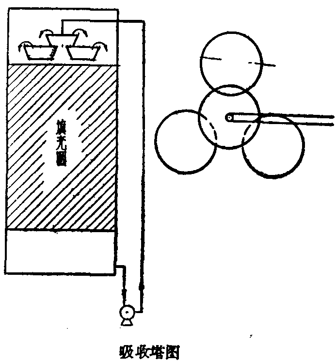

喷酸用的布酸器有现成的陶器布酸器供应。如果，没有陶器布酸器，可以用瓷杯堆成分布器。堆的方法是下层用三只瓷杯平放在填圈上，三只瓷杯上再放一只瓷杯，由泵浦打入塔内的酸先注上层一只瓷杯内，一部分溢入填充圈中，一部分溢入下层三只瓷杯内，再由三只瓷杯溢出，分散溢入填充圈，使其分布均匀。

冷却器可以用玻璃管制成，式样与氧化氮气体冷却器相同，冷却器的面积为第一塔3米²，第二塔2米²第三塔2米²第四与第五塔亦为2米²，但可不装冷却器。

循环酸用的酸泵是用硬木制成。内部用过氯乙烯清漆涂六七次，耐酸情况尚好。每小时的输送量在8米³左右，高度可达8米。上海铭黄厂制的木泵已应用在土法硝酸生产中，今后将改用硬聚氯乙烯材料制造，则耐酸情况更好。

=== "SVG 重绘"

    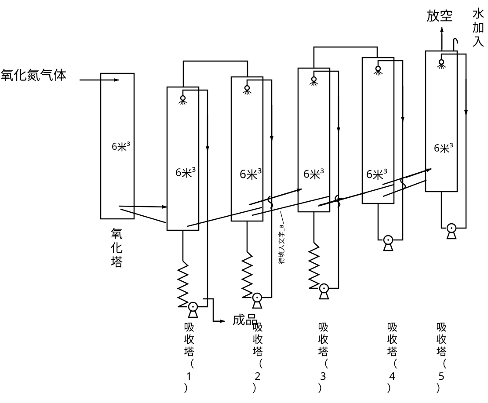

    > 此重绘图仍有待核图注，可切换到原书扫描对照。

=== "原书扫描"

    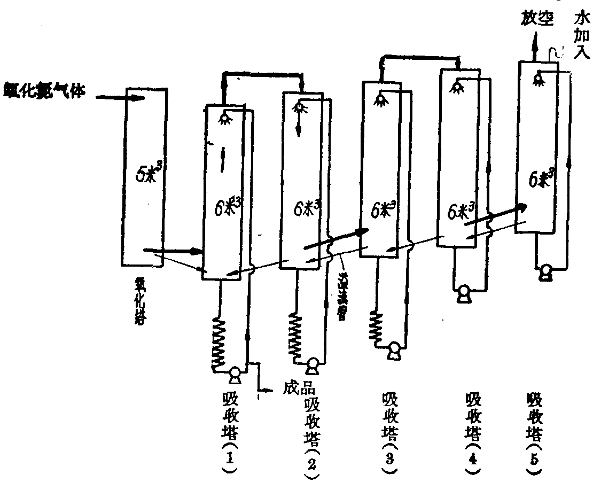

单排吸收系统流程图

=== "SVG 重绘"

    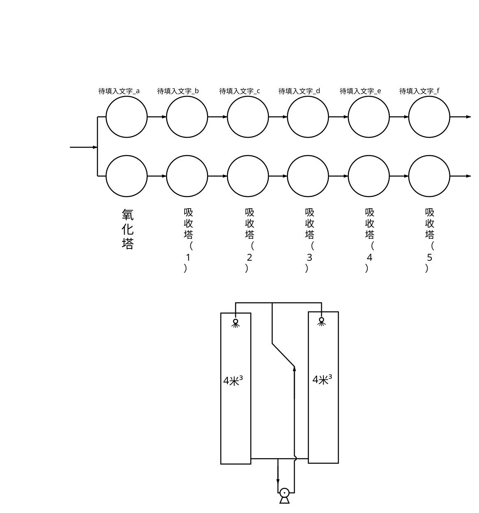

    > 此重绘图仍有待核图注，可切换到原书扫描对照。

=== "原书扫描"

    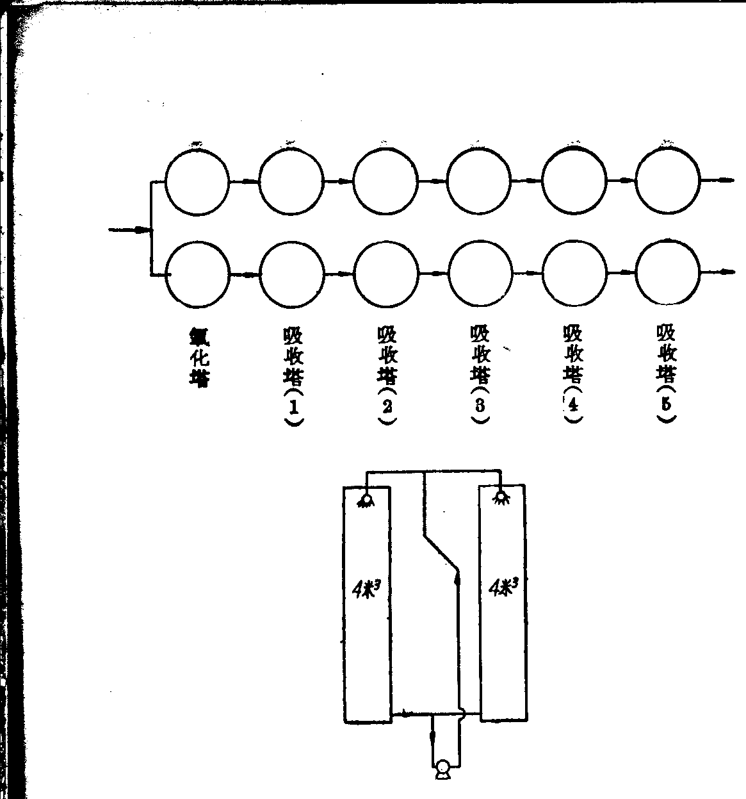

双排平联吸收系统流程图

---

**原扫描页**：[p06](../assets/scans/p06.png) · [p07](../assets/scans/p07.png) · [p08](../assets/scans/p08.png) · [p09](../assets/scans/p09.png) · [p10](../assets/scans/p10.png) · [p11](../assets/scans/p11.png) · [p12](../assets/scans/p12.png) · [p13](../assets/scans/p13.png) · [p14](../assets/scans/p14.png) · [p15](../assets/scans/p15.png) · [p16](../assets/scans/p16.png) · [p17](../assets/scans/p17.png) · [p18](../assets/scans/p18.png) · [p19](../assets/scans/p19.png) · [p20](../assets/scans/p20.png) · [p21](../assets/scans/p21.png) · [p22](../assets/scans/p22.png) · [p23](../assets/scans/p23.png) · [p24](../assets/scans/p24.png) · [p25](../assets/scans/p25.png) · [p26](../assets/scans/p26.png) · [p27](../assets/scans/p27.png)
