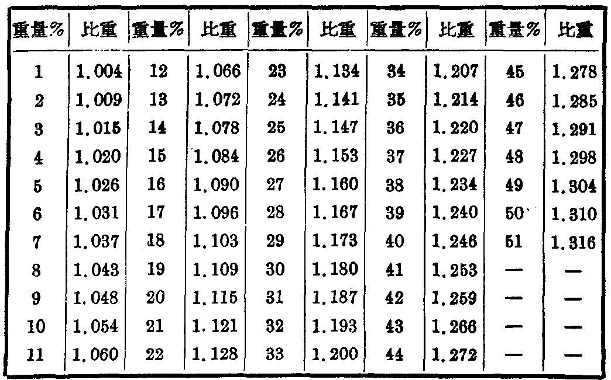

# 生产控制分析方法

## 二、 生产控制分析方法

## (1) 氨氧化效率的分析方法：

氨的氧化效率是指氨通过触媒后被氧化成一氧化氮的效率。因为氨經触媒后轉化生成一氧化氮，但是有一部分氨被分解成氮，其反应如下：

生成一氧化氮$4\ NH_{3}+5O_{2}=4NO+6\ H_{2}O$

生成氮气$4\ NH_{3}+3O_{2}=2N_{2}+6\ H_{2}O$

如果，在通过触媒前氨一空气混合气中；测得含化合氮的百分比和已通过触媒后的氧化氮混合气中含化合氮的百分比，两者的比值即可求得氧化效率。分析的方法是取容积500毫升的真空球二只，用蒸馏水清洗三次，然后将真空球玻璃活塞擦干净，仔細涂上一层凡士林，用真空泵将瓶内空气抽出（約需4~5分鐘)，并仔细地檢查真空球活塞处有无漏气现象，然后用清洁细布将球表面擦干净，放在天平上准确称量。将已经称好的二只真空球在氨氧化炉取样孔处，取通过触媒前的气体与通过触媒的气体。取样完毕后，再放在天平上称其重量。取样前后重量之差即样品的重量。将蒸馏水注入真空球内，并加剧烈摇蕩，待球内中的气体被水吸收后，分别倒入500毫升錐形瓶内(注意残余气不得逸出)。如此相繼三次，至球内气体完全被水吸收为止，洗液共約200毫升左右，加入甲基紅指示剂各2~4滴，然后再行滴定。氨气混合气试样用0.1N硫酸标准溶液滴定，氧化氮混合气体試样用0.1N氫氧化鈉溶液滴定。滴定的結果按下列公式計算：

氨-空气混合气体的含化合氮量%：

$$
\frac{N_{\mathrm{H_2SO_4}}\times V_{\mathrm{H_2SO_4}}\times\frac{14}{1000}}{W_1}\times100\qquad(1)
$$

氧化氮混合气体含化合氮量%：

$$
\frac{N_{\mathrm{NaOH}}\times V_{\mathrm{NaOH}}\times\frac{14}{1000}}{W_2}\times100\qquad(2)
$$

$$
\text{氧化效率}\%=\frac{\text{氧化氮混合气体中含化合氮量}}{\text{氨-空气混合气体中含化合氮量}}\times100
$$

式中：

$N_{\mathrm{H_{2}SO_{4}}}$ 滴定所用的硫酸濃度以N計。$V_{\mathrm{H_{2}SO_{4}}}$ 滴定所用硫酸量以毫升計。$N_{\mathrm{NaOH}}$ 滴定所用氢氧化鈉濃度以N計。$V_{\mathrm{NaOH}}$ 滴定所用氢氧化鈉量以毫升計。$W_{1}$ 氨-空气混合气取的样品重量(克)。

$W_{2}$ 氧化氮混合气取的样品重量（克）。

## (2) 硝酸濃度的测定：

在吸收塔中产生的硝酸，必須經常測定其酸液的濃度，以便控制。一般在土法生产中，可以做到濃度达45%的硝酸。如果冷却情况较好，硝酸的濃度也可达到49%。測定的方法是在吸收塔内(第一个吸收塔)取出样品，放在200毫升的量筒中，用比重表测量其比重，然后再查出其濃度(%)。

20℃时硝酸的比重与濃度(重量%)的对照表

| 重量% | 比重 | 重量% | 比重 | 重量% | 比重 | 重量% | 比重 | 重量% | 比重 |
| --- | --- | --- | --- | --- | --- | --- | --- | --- | --- |
| 1 | 1.004 | 12 | 1.066 | 23 | 1.134 | 34 | 1.207 | 45 | 1.278 |
| 2 | 1.009 | 13 | 1.072 | 24 | 1.141 | 35 | 1.214 | 46 | 1.285 |
| 3 | 1.015 | 14 | 1.078 | 25 | 1.147 | 36 | 1.220 | 47 | 1.291 |
| 4 | 1.020 | 15 | 1.084 | 26 | 1.153 | 37 | 1.227 | 48 | 1.298 |
| 5 | 1.026 | 16 | 1.090 | 27 | 1.160 | 38 | 1.234 | 49 | 1.304 |
| 6 | 1.031 | 17 | 1.096 | 28 | 1.167 | 39 | 1.240 | 50 | 1.310 |
| 7 | 1.037 | 18 | 1.103 | 29 | 1.173 | 40 | 1.246 | 51 | 1.316 |
| 8 | 1.043 | 19 | 1.109 | 30 | 1.180 | 41 | 1.253 | — | — |
| 9 | 1.048 | 20 | 1.115 | 31 | 1.187 | 42 | 1.259 | — | — |
| 10 | 1.054 | 21 | 1.121 | 32 | 1.193 | 43 | 1.266 | — | — |
| 11 | 1.060 | 22 | 1.128 | 33 | 1.200 | 44 | 1.272 | — | — |

---

**原扫描页**：[p30](../assets/scans/p30.png) · [p31](../assets/scans/p31.png) · [p32](../assets/scans/p32.png)
