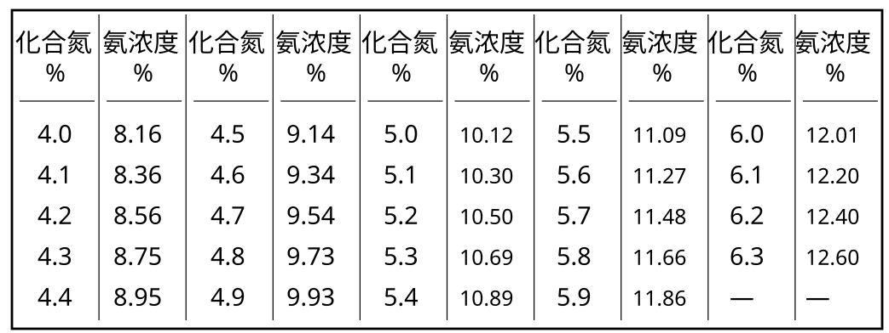
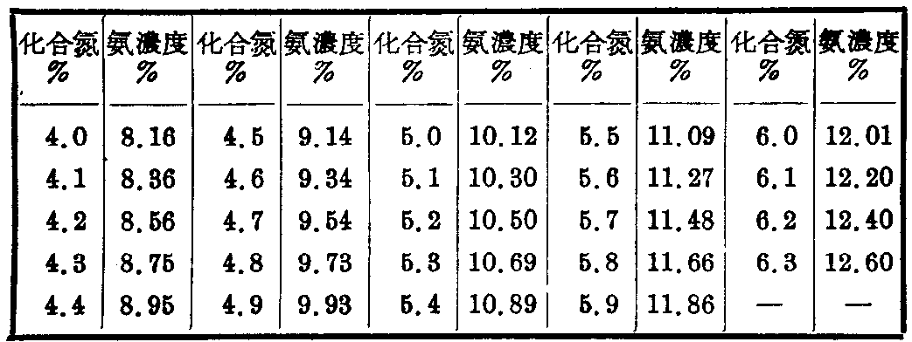

# 生产操作方法

## 三、 生产操作方法

## (1) 氨氧化炉的操作法：

在氨的氧化部分，应经常注意送入氧化炉中的氨与空气的流量，保持氨的浓度在9.5~10.5%左右。在使用一层铂网与非铂触媒结合使用时（非铂触媒指铁铋及铁铬等金属氧化物触媒)，氨的浓度可保持在10~10.5%左右。在单独使用非铂触媒时，氨的浓度应保持在10%左右。如氨的浓度过高，则氧化效率将会降低。控制的方法是将空气调节至一定流量后，再控制氨的送入量。如每天使用液氨500公斤，每小时送入的氨气量为$\frac{500\times22.4}{17\times24}=27.5$立方米/小时。假使氨浓度为10%时，空气的流量应为$\frac{27.5-(27.5\times0.1)}{0.1}=247.5$立方米/小时。由于流量计可能会有误差,因此必须分析氨-空气混合气中化合氮的含量；来参考氨浓度是否控制得正常(分析氧化效率时，氨-空气混合气中化合氮的含量%，可按下表查出浓度%，因此，可以在分析氧化效率时，同时查对氨的浓度）。

氨一空气混合气中化合氮含量与浓度对照表

| 化合氮 % | 氨浓度 % |
| --- | --- |
| 4.0 | 8.16 |
| 4.1 | 8.36 |
| 4.2 | 8.56 |
| 4.3 | 8.75 |
| 4.4 | 8.95 |
| 4.5 | 9.14 |
| 4.6 | 9.34 |
| 4.7 | 9.54 |
| 4.8 | 9.73 |
| 4.9 | 9.93 |
| 5.0 | 10.12 |
| 5.1 | 10.30 |
| 5.2 | 10.50 |
| 5.3 | 10.69 |
| 5.4 | 10.89 |
| 5.5 | 11.09 |
| 5.6 | 11.27 |
| 5.7 | 11.48 |
| 5.8 | 11.66 |
| 5.9 | 11.86 |
| 6.0 | 12.01 |
| 6.1 | 12.20 |
| 6.2 | 12.40 |
| 6.3 | 12.60 |

接触反应的温度，在氨氧化部分亦是重要的控制点。反应温度的高低可以在氨氧化炉中所装的热电偶指示出来。一般使用一层铂网与非铂触媒结合使用时，接触反应的温度可以控制在750℃左右。单独使用非铂触媒时，温度可控制在700℃左右(这主要看非触媒的性能来决定)。反应温度控制的方法可以调节预热温度来控制。如氨浓度控制正常，反应温度高时，可以降低预热空气的温度，反之则提高预热温度。调节预热温度时，可以把通入热交换器中的空气量来控制。如要预热温度高，则把通入热交换器中的空气阀开大，使加热的空气量增多。

=== "SVG 重绘"

    

=== "原书扫描"

    

触媒上反应的好坏，必须依靠分析氧化效率才能知道。因此，在正常操作时，每四小时须分析一次。如果，在生产变动时，则应多做几次，以便及时掌握情况。使用一层铂网与非铂触媒结合使用时，其氧化率在95~96%左右。单独使用非铂触媒，它的氧化效率在70~85%左右。

## (2) 吸收系统的操作法：

吸收部分在开车时，由于塔内酸的浓度不高，因此不必加水。在吸收数小时后，第一塔内酸的浓度达到需要的浓度时(一般控制在45%)，则在最后一塔内注入水。加入水量的多少，决定于第一塔的出酸浓度。如第一塔出酸的浓度为45%，或且浓度增高，则最后一塔所加的水略为增大，如浓度降低，则将水量关小。因此，应经常用比重表测定第一塔的酸浓度，以便及时地控制最后一塔的加水量。

如果安装有尾气的回收塔，则应在回收塔中用碱液吸收氧化氮气体。这样，不但可以提高效率，而且可以制造一部分亚硝酸钠产品。碱液吸收塔中可以用30%的碱液循环吸收，待碱度降低至3%左右时，另换新的碱液吸收。

在吸收过程中；希望温度低则对吸收有利。因此，在各冷却器上应有充分的水给予冷却，所以应经常注意冷却水的适当调节。

---

**原扫描页**：[p32](../assets/scans/p32.png) · [p33](../assets/scans/p33.png) · [p34](../assets/scans/p34.png)
