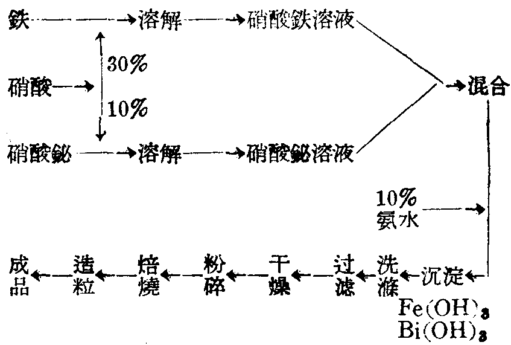

# Manufacture of the oxidation catalyst

Non-platinum catalysts, such as iron–bismuth or iron–chromium, combined with one platinum gauze can achieve about 95–96% conversion of ammonia to nitric oxide. This is close to the conversion achieved by three platinum gauzes and substantially reduces platinum consumption. Dye, textile-printing and pharmaceutical plants in Shanghai had already used a combined iron–bismuth/platinum bed, absorbing the oxidation products directly in alkaline solution to make sodium nitrite.

Because platinum gauze was still difficult to obtain domestically, non-platinum catalysts alone were also used. Under good control, their conversion could reach 70–85%. Limited experience with this mode called for further work to improve both conversion and catalyst life.

## Raw materials for an iron–bismuth catalyst

| Material | Description |
| --- | --- |
| Nitric acid | 30% concentration |
| Iron | Electrolytic or relatively pure iron, such as welding rods |
| Bismuth nitrate | Industrial-grade $\mathrm{Bi(NO_3)_3\cdot5H_2O}$; metallic bismuth may replace it |
| Aqueous ammonia | 10% solution; ammonium carbonate solution is also mentioned |

## Manufacturing principles

Iron is dissolved in nitric acid to form ferric nitrate:

$$
\mathrm{Fe}+6\mathrm{HNO_3}=\mathrm{Fe(NO_3)_3}+3\mathrm{NO_2}+3\mathrm{H_2O}
$$

Bismuth is dissolved in nitric acid to form bismuth nitrate:

$$
\mathrm{Bi}+6\mathrm{HNO_3}=\mathrm{Bi(NO_3)_3}+3\mathrm{NO_2}+3\mathrm{H_2O}
$$

Neutralization of the mixed nitrate solution with aqueous ammonia precipitates hydroxides:

$$
\begin{aligned}
\mathrm{Fe(NO_3)_3}+\mathrm{NH_4OH}&=\mathrm{Fe(OH)_3}+3\mathrm{NH_4NO_3}\\
\mathrm{Bi(NO_3)_3}+3\mathrm{NH_4OH}&=\mathrm{Bi(OH)_3}+3\mathrm{NH_4NO_3}
\end{aligned}
$$

> Editorial note: the original omits the coefficient 3 before NH₄OH in the first precipitation equation. The transcription and translation retain the printed equation rather than silently balancing it.

The mixed precipitate, $\mathrm{[Fe(OH)_3+Bi(OH)_3]}$, decomposes on heating:

$$
\begin{aligned}
2\mathrm{Fe(OH)_3}&\longrightarrow\mathrm{Fe_2O_3}+3\mathrm{H_2O}\\
2\mathrm{Bi(OH)_3}&\longrightarrow\mathrm{Bi_2O_3}+3\mathrm{H_2O}
\end{aligned}
$$

## Manufacturing process

### Materials for one kilogram of catalyst

| Material | Amount |
| --- | --- |
| Iron | 0.664 kg |
| Nitric acid, 30% | 14.6 kg |
| Bismuth nitrate pentahydrate | 0.104 kg |
| Metallic bismuth, if substituted | 0.045 kg |
| Aqueous ammonia, 10% | Enough for complete precipitation and a slightly alkaline solution |

The resulting catalyst contains 95% iron oxide and 5% bismuth oxide.

### Sequence described in the book

Put 30% industrial nitric acid in a ceramic vessel and add iron in portions. The reaction is vigorous; adding too much iron causes the foaming ferric nitrate solution to overflow, so addition is gradual. Yellow nitrogen-oxide gas evolves. The text places the operator upwind to avoid inhalation and poisoning, preferably in an open area or with a wooden chimney above the vessel to discharge gas at a height.

Once the iron has dissolved, the solution is reddish brown. Dissolve bismuth nitrate in 10% nitric acid, add it slowly to the ferric nitrate solution, and stir periodically to mix thoroughly.

With continuous stirring, add 10% aqueous ammonia slowly to the mixed nitrate solution, precipitating iron and bismuth hydroxides. Stop addition when litmus paper indicates slight alkalinity. Let the precipitate settle, siphon off the clear supernatant with rubber tubing, and wash the precipitate thoroughly with distilled water. After six or seven washes, transfer it to a fine-cloth bag and filter out water.

Dry the filtered precipitate in an oven and grind it to powder. Calcine the dry powder for about four hours at 500–600°C. Form the calcined material in a tablet press into particles 3–5 mm in diameter and 3 mm long.

Without a tablet press, the book describes drying the precipitate at 80°C, grinding it, mixing it with distilled water to a paste, and extruding strands. The extruder could be homemade or a hand-operated meat grinder. Dry the strands, break them into particles of the stated size, and then calcine.

The preparation of iron–bismuth and iron–chromium catalysts is broadly similar. The text concentrates on iron–bismuth because chromium compounds were difficult to purchase, while the iron–bismuth materials were domestically available and relatively inexpensive.

The reported iron–bismuth catalyst density is approximately 1.3 kg/L. A 0.9 m diameter oxidizer with an 80 mm bed requires about 66 kg of catalyst and processes approximately 500 kg of ammonia per day. Combined with one platinum gauze, the same daily ammonia throughput requires an oxidizer only 0.46 m in diameter, a 50 mm bed and about 12 kg of catalyst.

---

**Scans**: [p35](../assets/scans/p35.png) · [p36](../assets/scans/p36.png) · [p37](../assets/scans/p37.png) · [p38](../assets/scans/p38.png)
