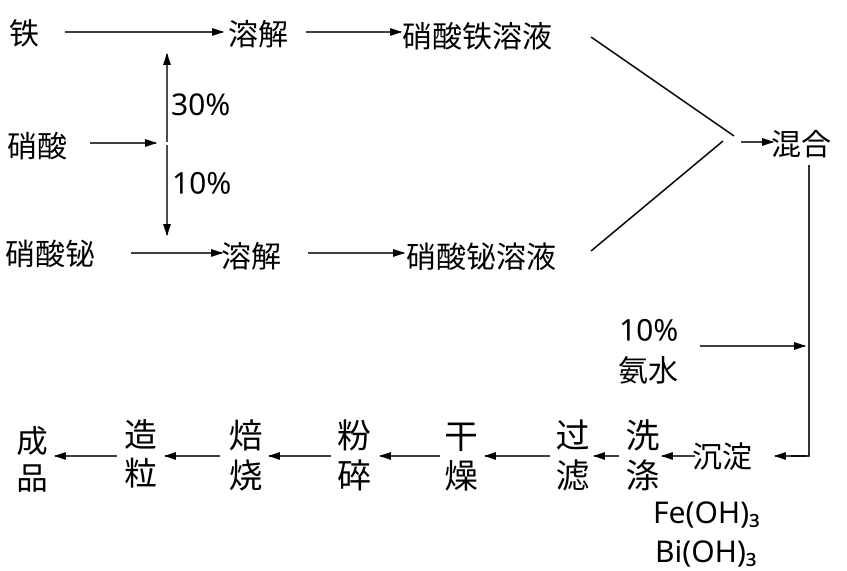

# 氨氧化触媒的制造

## 五、 氨氧化用触媒的制造方法

非铂触媒（铁铋或铁铬等触媒）与一层铂网结合使用时，氨转化成一氧化氮的转化率可达95~96%以上。因此与使用三层铂网作接触剂时转化率来比较，二者没有多大差别，但对节约铂的消耗具有很重大的经济意义。目前上海已有染料，印染和医药等工业采用铁铋触媒与一层铂网结合使用作为氨氧化触媒，使氨氧化后，直接用碱液吸收制成亚硝酸钠。因为国内铂网的供应暂时还存在一定的困难，如果单独使非铂触媒，在良好的操作控制条件下，其转化率亦能达70~85%。由于使用单纯的非铂触媒的经验不足，所以尚须摸索经验，以使其转化率及使用寿命能不断的提高。

铁铋触媒的制法:

(1)原料：

硝酸30%浓度。

铁电解铁或较纯的铁、如焊条等。

硝酸铋：用工业纯硝酸铋，含 5 个分子的结晶水 $\mathrm{Bi(NO_3)_3\cdot5H_2O}$，如无硝酸铋时，亦可用金属铋。

氨水10%的氨水或用碳酸铵溶液亦可。

(2)制造原理：

用铁与硝酸制造硝酸铁的反应如下:

$$
\mathrm{Fe}+\mathrm{6}\ \mathrm{HNO_{3}}=\mathrm{Fe}(\mathrm{NO_{3}})_{3}+\mathrm{3NO_{2}}+\mathrm{3}\ \mathrm{H_{2}O}
$$

用铋与硝酸制造硝酸铋的反应如下:

$$
\mathrm{Bi}+\mathrm{6}\ \mathrm{HNO_{3}}=\mathrm{Bi}(\mathrm{NO_{3}})_{3}+\mathrm{3NO_{2}}+\mathrm{3}\ \mathrm{H_{2}O}
$$

硝酸铁与硝酸铋混合液用氨水中和产生氢氧化物的沉淀反应：

$$
\begin{aligned}&\mathrm{Fe}(\mathrm{NO}_{3})_{3}+\mathrm{NH}_{4}\mathrm{OH}=\mathrm{Fe}(\mathrm{OH})_{3}+3\mathrm{NH}_{4}\mathrm{NO}_{3}\\ &\mathrm{Bi}(\mathrm{NO}_{3})_{3}+3\mathrm{NH}_{4}\mathrm{OH}=\mathrm{Bi}(\mathrm{OH})_{3}+3\mathrm{NH}_{4}\mathrm{NO}_{3}\\ \end{aligned}
$$

所制得的混合沉淀物$\mathrm{[Fe(OH)_3+Bi(OH)_3]}$ 加热分解时的反应：

$$
\begin{aligned}&\mathrm{2Fe(OH)_{3}\longrightarrow Fe_{2}O_{3}+3H_{2}O}\\ &\mathrm{2Bi(OH)_{3}\longrightarrow Bi_{2}O_{3}+3H_{2}O}\\ \end{aligned}
$$

(3)制造过程:

1. 制造1公斤铁铋触媒所需原料的消耗量:

铁0.664公斤。

硝酸14.6公斤（指30%硝酸）。

硝酸铋0.104公斤(指5分子结晶水)，如改用金属铋时，需0.045公斤。

氨水10%氨水加入的量要使沉淀全部产生后而溶液又呈微碱性。

以上制成的铁铋触媒成分；含氧化铁95%，含氧化铋5%。

2. 制造顺序：在瓷缸中加入30%的工业硝酸，然后将铁分批加入，铁在硝酸中的反应进行得很剧烈。如铁的量加入太多，则会造成泡沫状的硝酸铁溶液溢出。因此，铁必须逐渐加入。在反应产生时，有大量的黄色氧化氮气体产生，所以操作人员必须立在上风向的地位，以免气体吸入呼吸道引起中毒(最好放在空旷的场地上，或缸上装一木烟囱，使气体散入高空)。待铁完全溶解后，此时溶液成红褐色的硝酸铁溶液。硝酸铋用10%的硝酸溶解后，缓缓加入硝酸铁溶液中，并不时搅拌，使硝酸铁与硝酸铋充分混和均匀，成为混合溶液。

> 校注：原书第一条沉淀反应式在 NH₄OH 前未印系数 3，此处照录，未按化学配平自行增补。

将以上的混合溶液，在不断的搅拌下，缓缓地将10%的氨水加入硝酸铁溶液中，使铁与铋生成氢氧化物沉淀。用石蕊试纸检验至溶液呈微碱性时，停止加入氨水。待沉淀物澄清后，用橡皮管吸出上部分澄清液体，再用蒸馏水把沉淀物充分洗涤，经6~7次的漂洗后，将沉淀倾入细布袋中，滤去水分。

过滤出的沉淀物置烘箱中烘干，然后将沉淀物磨成粉末，再将干燥的粉末置于焙烧炉中焙烧4小时左右，温度维持在500～600℃

焙烧后的触媒，在压片机上压成对径3~5毫米，长3毫米的颗粒。

假使没有压片机，可将沉淀物在80℃温度下烘干，磨成细粉后，再用蒸馏水拌成泥状后放在挤条机中挤成条状(挤条机可以自制的或用手摇碎肉机亦可，挤出的条烘干后，碎成以上规格颗粒，再行焙烧）。

触媒的制造过程如下：

=== "SVG 重绘"

    

=== "原书扫描"

    

(注：制造铁铋触媒与铁铬触媒方法大致相似，因市场上铬化合物不易购得，故介绍的以铁铋触媒为主，因其都是国产原料，价格亦较低廉）。

铁铋触媒的密度约为1.3公斤/升。如以对径0.9米的氨氧化炉，触媒层高度为80毫米时，需用触媒约66公斤左右。每天转化氨量约为500公斤左右。如果与一层铂网结合使用，每天转化氨500公斤，炉子的对径只须0.46米，触媒层高度为50毫米，需用触媒量约12公斤左右。

---

**原扫描页**：[p35](../assets/scans/p35.png) · [p36](../assets/scans/p36.png) · [p37](../assets/scans/p37.png) · [p38](../assets/scans/p38.png)
